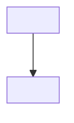

# Template: `docs/ARCHITECTURE.md`

How the system is structured: components, data flow, key design decisions, module boundaries.

Format rules:

- The file always opens, under its title, with one status line: `> **Status (YYYY-MM-DD):** built: …; designed, not built: …`. It stays one line; the "Code built that was designed" line of the maintenance map keeps it current.
- Apply the skill's diagramming policy: prose, tables and ASCII trees by default; Mermaid only for the one or two flows that earn it.
- Each diagram carries a "Constraints:" list directly under it, for the rules the diagram cannot show.
- Mark what the code does not settle as a TODO in prose; never guess a topology.

````markdown
# Architecture

> **Status (YYYY-MM-DD):** built: <components that exist in code>; designed, not built: <components only in docs or PRDs>.

## Overview

<What the system is made of and how a request or job moves through it.>

## Components

| Component | Responsibility | Lives in |
|---|---|---|
| <name> | <one line> | `<path>` |

## <Flow that earns a diagram>



**Constraints:**

- <A rule the diagram can't carry, such as "must be idempotent".>

## Key design decisions

- **<Decision>.** <Why, and the trade-off accepted.>
````
